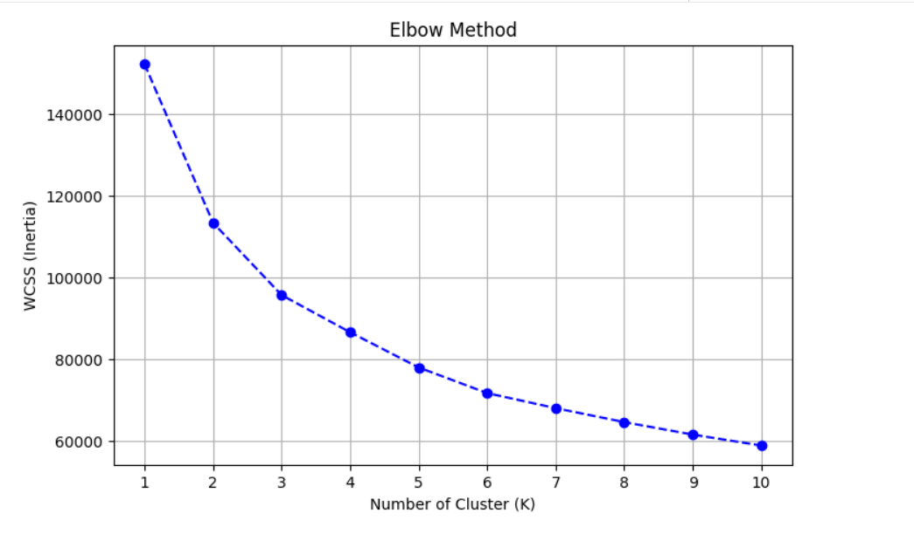
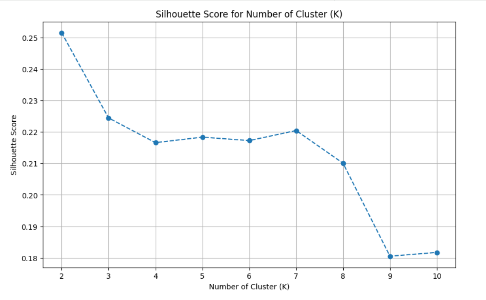
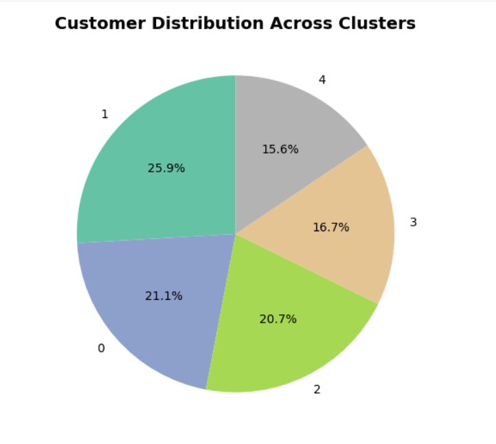
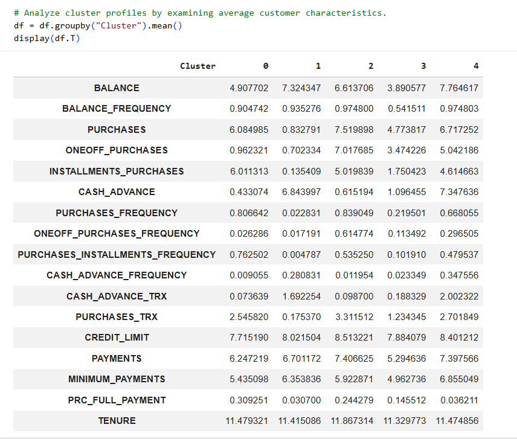
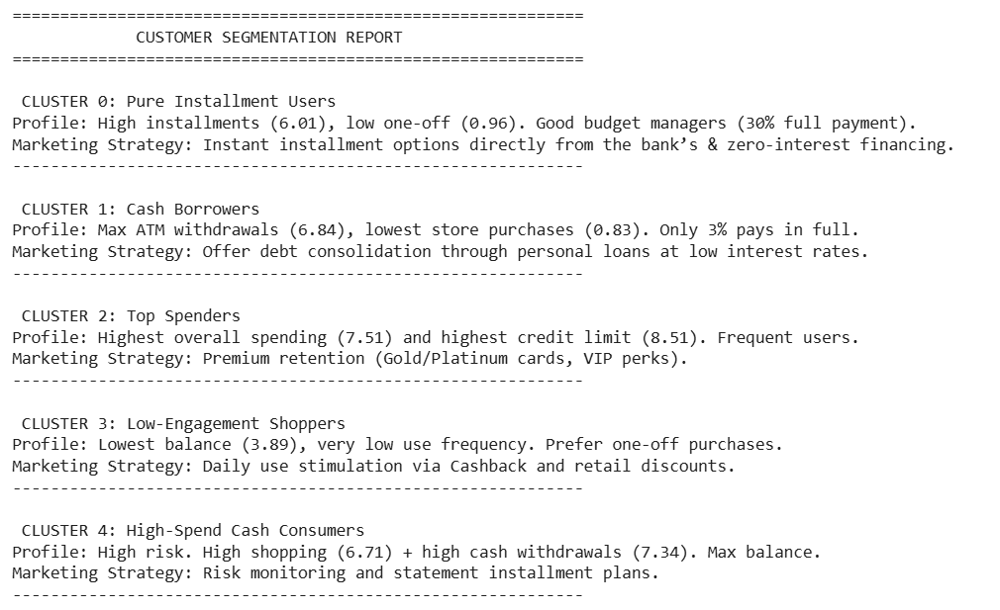

# 💳 Customer Segmentation for Targeted Marketing Campaigns
## 📌 Project Overview
This project focuses on developing a customer segmentation model using Machine Learning clustering techniques to support targeted marketing campaigns for FinTech Solutions S.p.A., a fictional company operating in the financial services sector.

The company aims to promote its credit card services more effectively by identifying groups of customers with similar spending behaviors, purchasing habits, and credit card usage patterns.

The project involves analyzing customer credit card data to identify similar customer segments based on financial behavior and card usage.

Through exploratory data analysis, data preprocessing, and K-Means clustering, the objective is to identify distinct customer profiles and provide insights that can support personalized marketing strategies.

The resulting customer segments can help the company optimize promotional campaigns, improve customer engagement, identify growth opportunities, and allocate marketing resources more efficiently.

## 🗂️ Dataset
**Source:** Credit Card Customer Dataset.

**Dataset:** Credit Card Customers.

**Number of Records:** 8,950 customers.

**Number of Variables:** 18 original variables, including the customer identifier.

**Main Data:** Credit card balances, purchase amounts, cash advances, payment behavior, credit limits, transaction frequency, and account age.

The dataset contains information about individual credit card holders and their financial behaviors.

The main variables include:

- **BALANCE**: Remaining account balance.
- **BALANCE_FREQUENCY:** Frequency of balance updates.
- **PURCHASES:** Total purchase amount.
- **ONEOFF_PURCHASES:** Total amount spent on one-off purchases.
- **INSTALLMENTS_PURCHASES:** Total amount spent on installment purchases.
- **CASH_ADVANCE:** Total cash advance amount.
- **PURCHASES_FREQUENCY:** Frequency of purchases.
- **ONEOFF_PURCHASES_FREQUENCY:** Frequency of one-off purchases.
- **PURCHASES_INSTALLMENTS_FREQUENCY:** Frequency of installment purchases.
- **CASH_ADVANCE_FREQUENCY:** Frequency of cash advances.
- **CASH_ADVANCE_TRX:** Number of cash advance transactions.
- **PURCHASES_TRX:** Number of purchase transactions.
- **CREDIT_LIMIT:** Maximum credit limit assigned to the customer.
- **PAYMENTS:** Total amount of payments made.
- **MINIMUM_PAYMENTS:** Minimum payment amount.
- **PRC_FULL_PAYMENT:** Percentage of full payments made.
- **TENURE:** Duration of the credit card service.
  
The **CUST_ID** variable was removed before the clustering analysis because it represents a customer identifier rather than a behavioral feature.

## 🎯 Project Objectives
The main objectives of the project were:

- Explore customer financial data and understand the distribution of the main variables.
- Identify missing values and verify data quality.
- Analyze variable distributions and identify highly skewed features.
- Prepare the dataset for Machine Learning through data cleaning and preprocessing.
- Apply logarithmic transformations to reduce the impact of highly skewed distributions.
- Standardize numerical variables to ensure comparable feature scales.
- Apply K-Means clustering to identify similar customer segments.
- Determine the optimal number of clusters using the Elbow Method and Silhouette Score.
- Analyze customer characteristics and identify distinct behavioral profiles.
- Develop targeted marketing strategies based on the characteristics of each customer segment.

## 🛠️ Tools & Techniques
- Python
- Google Colab
- Pandas
- NumPy
- Matplotlib
- Scikit-learn
- Exploratory Data Analysis (EDA)
- Data Cleaning
- Missing Value Imputation
- Descriptive Statistics
- Skewness Analysis
- Logarithmic Transformation (np.log1p)
- Feature Scaling
- Standardization (StandardScaler)
- K-Means Clustering
- K-Means++ Initialization
- Elbow Method
- Within-Cluster Sum of Squares (WCSS)
- Silhouette Score
- Cluster Profiling
- Customer Segmentation
- Marketing Strategy Development

## 📂 Project Structure
The project follows a structured Machine Learning workflow, starting with data exploration and preprocessing and continuing with clustering, model evaluation, and customer segmentation.

The analysis was developed in Python using Google Colab.

## 1. Data Loading and Initial Inspection
The dataset was imported using Pandas and inspected to understand its structure and characteristics.

Key analytical activities:

- Importing the dataset containing 8,950 customer records and 18 variables.
- Inspecting the dataset dimensions and data types.
- Removing the CUST_ID identifier.
- Calculating descriptive statistics to understand the distribution and variability of the numerical variables.
- Identifying missing values across the dataset.

## 2. Data Cleaning and Missing Value Treatment
The dataset was examined to identify and manage missing observations.

Key analytical activities:

- Checking missing values in each variable.
- Identifying rows containing more than 25% missing values.
- Replacing missing values in MINIMUM_PAYMENTS using the median.
- Replacing the missing value in CREDIT_LIMIT using the mean.
- Verifying the completeness of the dataset after imputation.

For MINIMUM_PAYMENTS, the median was chosen, since the variable had extreme values and a highly skewed distribution.

## 3. Skewness Analysis and Logarithmic Transformation
The distributions of numerical variables were analyzed to identify highly skewed features.

Key analytical activities:

- Calculating skewness values for all numerical variables.
- Identifying features with highly asymmetric distributions.
- Applying the np.log1p() transformation to selected variables.
- Comparing skewness values before and after logarithmic transformation.

The logarithmic transformation was applied to the following variables:

- MINIMUM_PAYMENTS
- ONEOFF_PURCHASES
- PURCHASES
- INSTALLMENTS_PURCHASES
- PAYMENTS
- CASH_ADVANCE_TRX
- CASH_ADVANCE
- PURCHASES_TRX
- BALANCE
- CREDIT_LIMIT

The transformation helped reduce distribution asymmetry and mitigate the influence of extreme values before clustering.

## 4. Feature Scaling and Standardization
After the logarithmic transformation, numerical variables were standardized using Scikit-learn's StandardScaler.

Key analytical activities:

- Initializing the StandardScaler.
- Standardizing all numerical features.
- Creating a scaled DataFrame for the clustering analysis.
- Verifying the transformation through descriptive statistics.

Standardization ensured that variables measured on different scales could contribute more comparably to the K-Means distance calculations.

## 5. Customer Segmentation Using K-Means
K-Means clustering was applied to identify groups of customers with similar financial behaviors and credit card usage patterns.

The model was configured using:

- **Algorithm:** K-Means.
- **Initialization:** K-Means++.
- **Random State:** 42.
- **Number of Initializations:** 10.
- **Number of Clusters:** 5.

The optimal number of clusters was investigated using the Elbow Method and Silhouette Score.

The final model assigned each customer to one of five distinct clusters based on their standardized financial and behavioral characteristics.

## 6. Cluster Evaluation
Two evaluation techniques were used to investigate the appropriate number of customer segments.

## Elbow Method
The Within-Cluster Sum of Squares (WCSS), also known as inertia, was calculated for different values of K.

The values ​​obtained were visualized to identify the point at which, as the number of clusters increased, improvements in cluster compactness became progressively smaller.

## Silhouette Score
The Silhouette Score was calculated for different numbers of clusters to evaluate the separation and cohesion of the resulting groups.

The metric ranges from -1 to +1:

- Values close to +1 indicate well-separated clusters.
- Values around 0 indicate overlapping clusters.
- Negative values ​​may indicate incorrectly assigned observations.

Based on the combined evaluation using the Elbow Method and Silhouette Score, five clusters were selected for the final segmentation model.

## 7. Customer Distribution Across Clusters
After training the final K-Means model, each customer was assigned to one of the five identified clusters.

The resulting distribution was:

| Cluster | Number of Customers |
|:---:|---:|
| 0 | 1,886 |
| 1 | 2,320 |
| 2 | 1,854 |
| 3 | 1,498 |
| 4 | 1,392 |
| **Total** | **8,950** |

A pie chart was developed to visualize the distribution of customers across the five segments.

## 8. Customer Profiling and Marketing Strategies
The five clusters were analyzed by examining the average characteristics of their respective customers.

Based on their financial behaviors and credit card usage patterns, five distinct customer profiles were identified.

## Cluster 0 – Pure Installment Users

- **Customer Profile:**

  These customers primarily use their credit cards for installment purchases, with a relatively low volume of single-payment transactions.
  They exhibit a high purchase frequency and, compared to other customer segments, a proportionally higher share of single-payment transactions.

- **Marketing Strategy:**

  Motivate continued card usage through flexible installment options and promotional financing solutions.

- **Recommended Actions:**

  - Offer installment payment options directly through the banking application.
  - Introduce promotional zero-interest financing where financially appropriate.
  - Develop personalized offers based on installment purchasing preferences.

## Cluster 1 – Cash Borrowers

- **Customer Profile:**

  These customers primarily use their credit cards for cash advances rather than regular purchases.
  They exhibit the highest average cash advance activity and the lowest purchase activity among the five segments.
  Their average full-payment ratio is also particularly low.

- **Marketing Strategy:**

  Focus on responsible credit management and offer alternatives that can help customers manage outstanding balances.

- **Recommended Actions:**

  - Offer financial guidance and debt management solutions.
  - Provide information about structured repayment options.
  - Evaluate suitable personal loan options with transparent terms and conditions.

## Cluster 2 – Top Spenders / VIP Customers

- **Customer Profile:**

  These customers represent the most active purchasing segment.
  They exhibit the highest average purchase activity, frequent card usage, and the highest average credit limit among the five clusters.
  They also show significant activity in both one-off and installment-based purchases.

- **Marketing Strategy:**

  Focus on customer retention and strengthen long-term relationships through premium services and exclusive benefits.

- **Recommended Actions:**

  - Develop premium loyalty programs.
  - Offer exclusive rewards and personalized benefits.
  - Introduce premium card services and personalized customer experiences.
  - Encourage ongoing engagement through targeted loyalty campaigns.

## Cluster 3 – Low-Engagement Shoppers

- **Customer Profile:**

  These customers show relatively low credit card usage and limited purchasing activity.
  They have the lowest average balance and relatively low purchase frequency compared with the other segments.
  Their card usage is less frequent and generally characterized by limited transaction activity.

- **Marketing Strategy:**

  Encourage greater engagement through incentives designed to increase everyday card usage.

- **Recommended Actions:**

  - Introduce cashback promotions.
  - Offer discounts on everyday purchases, such as groceries and fuel.
  - Develop targeted campaigns to re-engage less active customers.
  - Encourage regular card usage through personalized incentives.

## Cluster 4 – High-Spend Cash Consumers

- **Customer Profile:**

  These customers combine consistent purchasing activity with frequent cash advances.
  They exhibit high average balances, significant spending activity, and relatively low average full-payment ratios.
  This combination suggests a customer segment that deserves particular attention from a credit risk management perspective.

- **Marketing Strategy:**

  Prioritize responsible credit management while maintaining a good relationship with clients.

- **Recommended Actions:**

  - Monitor credit utilization and cash advance activity.
  - Provide structured repayment options.
  - Promote financial planning and responsible credit usage.
  - Avoid aggressive promotional campaigns that could encourage excessive debt.
  
## 💡 Business Value
Customer segmentation provides FinTech Solutions S.p.A. with valuable insights into customer behavior and opportunities for more effective marketing strategies.

The main potential business benefits include:

- **Targeted Marketing Campaigns:** Identifying homogeneous customer groups allows the company to develop more relevant promotional campaigns based on individual spending and purchasing behaviors.
- **Customer Retention:** Recognizing high-spending and highly engaged customers supports the development of personalized loyalty programs and premium services.
- **Customer Engagement:** Identifying less active customers helps the company design targeted incentives to encourage regular credit card usage.
- **Responsible Credit Management:** Identifying customers who frequently use cash advances and have low debt repayment rates can highlight segments that may require closer monitoring and financial support.
- **Personalized Financial Products:** Understanding different purchasing and payment behaviors creates opportunities to develop financial products and services that better match customer needs.
- **Marketing Resource Optimization:** Segment-based strategies allow the company to allocate marketing resources more efficiently and focus on campaigns with greater potential relevance.

## 🎓 Conclusion
This project demonstrates how Machine Learning clustering techniques can be applied to customer financial data to identify meaningful behavioral segments and support targeted marketing strategies.

Through exploratory data analysis, data cleaning, logarithmic transformation, feature standardization, and K-Means clustering, five distinct customer profiles were identified.

The combination of the Elbow Method and Silhouette Score supported the selection of five clusters, while the subsequent cluster profiling helped translate the model results into practical marketing recommendations.

Overall, the project strengthened my practical skills in Python, data preprocessing, exploratory data analysis, feature scaling, unsupervised Machine Learning, K-Means clustering, model evaluation, and customer segmentation.

It also demonstrated the importance of translating analytical findings into operational business insights to support data-driven decision making.

## 📁 Repository Contents
- **[Customer_segmentation_for_targeted_marketing_campaigns.ipynb](Customer_segmentation_for_targeted_marketing_campaigns.ipynb):** Google Colab notebook containing the complete analysis, data preprocessing, K-Means implementation, model evaluation, and customer segmentation.
- **[DATA](DATA):** Folder containing the original credit card customer dataset.
- **[images](images):** Folder containing screenshots of the main analytical visualizations and clustering results.

## 📸 Project Preview
## 1. Elbow Method
Evaluation of the Within-Cluster Sum of Squares (WCSS) to investigate the optimal number of clusters.

## 2. Silhouette Score
Evaluation of cluster cohesion and separation across different values of K.

## 3. Customer Distribution Across Clusters
Distribution of the 8,950 customers across the five identified segments.

## 4. Cluster Profiles
Comparison of the average behavioral and financial characteristics of the five customer segments.

## 5. Cluster Recommendations
Overview of the five customer profiles and their corresponding marketing strategies.

## 📬 Contact
- **Silvia Venturini**
- [LinkedIn](https://www.linkedin.com/in/silvia-venturini92/)
- **Email:** silvia.venturini92@hotmail.com
